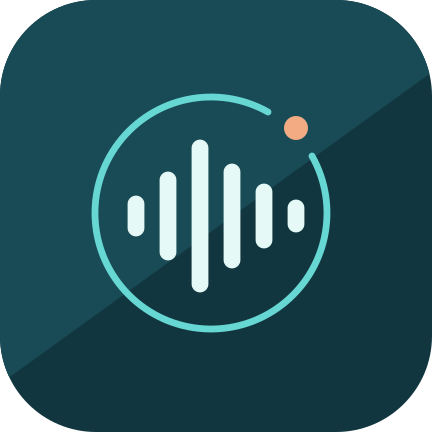
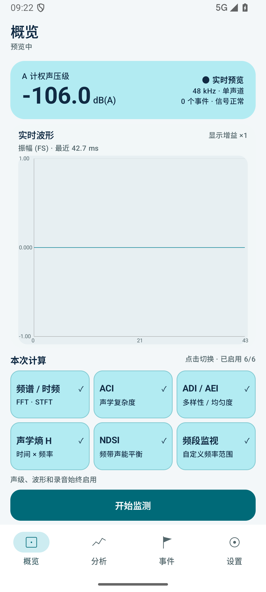
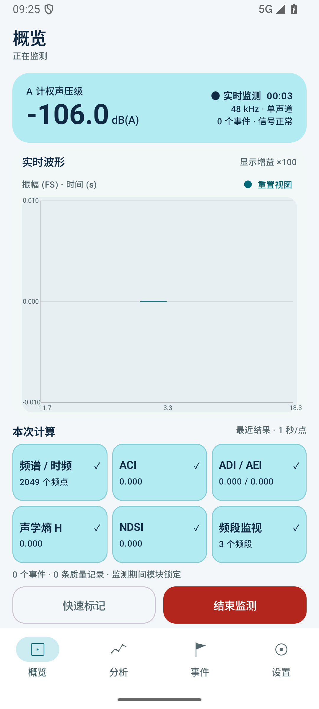
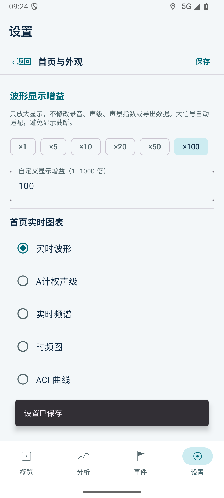
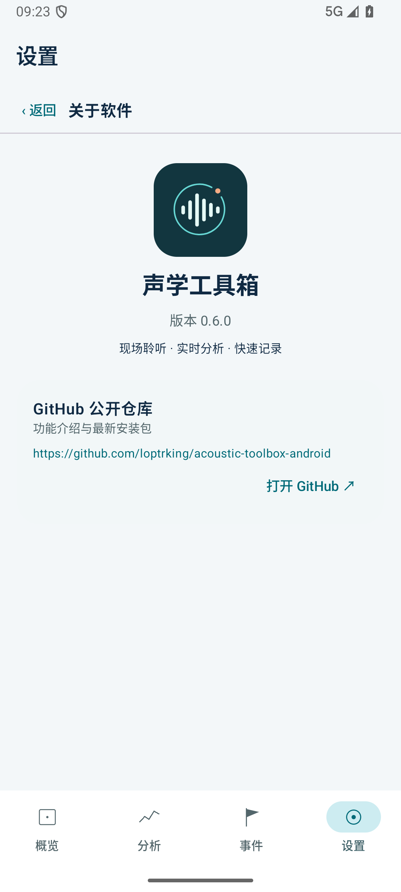

# 声学工具箱 Android（Acoustic Toolbox）

一个面向现场快速判断与短时声景观察的 Android 实时声学工具箱。应用使用手机内置麦克风，以 48 kHz、单声道持续采集音频，在同一条实时数据流上完成 A 计权声级、波形、频谱、时频图、声景指数、频段监测和事件快照记录。

项目当前版本为 **v0.6.0**。它不是海量历史数据的移动端批处理器，也不替代经过检定的专业声级计；核心目标是把现场记录、实时计算、图表观察和会话导出整合到一个可运行的移动应用中。

## 最新安装包

- [下载 AcousticToolbox-v0.6.0-debug.apk](release/AcousticToolbox-v0.6.0-debug.apk)
- SHA-256：`56C62FC77397F81C2CE542CBB992FDC75B7CD6B666749CD329DDB746A91DE02E`
- 最低系统版本：Android 10（API 29）

> 仓库只保留最新 APK。安装包适用于 Android 10 及以上系统。

## 界面预览

以下截图展示应用的主要页面布局，具体内容以当前安装版本为准。

  
  
  
  

## 主要能力

### 实时预览与会话状态

- 获得麦克风权限后，未开始正式监测也可以查看当前 A 计权声级和实时波形。
- 开始前由用户选择本次会话需要启用的分析模块，避免无用计算、耗电和数据量。
- 首页采用不需上下滚动的紧凑单屏布局：声级卡片、实时图表、六宫格模块选择和会话操作一页展示；横屏时采用左右分栏。
- 六宫格对应频谱/时频、ACI、ADI/AEI、H、NDSI 和频段监视。点击格子切换启用状态并改变颜色；监测后格子展示最新结果，模块选择锁定。
- 正式会话采用 `PREVIEW → RUNNING → ENDED → EXPORTING` 状态管理。
- 单次会话最长 60 分钟，正式监测期间录制 48 kHz / Mono / PCM 16-bit WAV。
- 开始新会话前提示上一会话数据将被清除，防止未导出的结果被无意覆盖。

### A 计权声级

- 实时输出 LAF、LAS、LAeq、LAFmax、LASmax、L10、L50 和 L90。
- 使用 A 计权频率响应与快、慢时间计权。
- 支持校准偏移量，但默认定位仍是现场相对判断工具。
- 输入削波、录音错误等情况会写入质量记录。

### 时域、频域与时频分析

- 实时波形与会话波形包络。
- 波形支持 1–1000 倍显示增益，可使用预设倍率或自定义；只改变显示尺度，不修改原始音频、测量值和导出数据。大信号与当前可见历史范围自动适配，不截断显示。
- 会话波形保留正负振幅，支持查看历史与重置视图。
- FFT 频谱和持续追加的 STFT 时频图。
- FFT 点数、窗函数、重叠率和刷新间隔可配置。
- 支持 Hann、Hamming 和矩形窗。
- 自定义频段监视器复用频谱结果，输出各频段相对能量时间序列。

### 声景指数

当前实现五项声景指数：

- **ACI**：Acoustic Complexity Index，描述频率单元随时间的幅值变化。
- **ADI**：Acoustic Diversity Index，基于有效频带能量比例的香农多样性。
- **AEI**：Acoustic Evenness Index，基于频带能量分布的均匀度。
- **H**：Acoustic Entropy，使用 `H = Ht × Hf`；Ht 来自 Hilbert 解析信号包络，Hf 来自平均幅度谱。
- **NDSI**：Normalized Difference Soundscape Index，比较两个可配置频带的功率比例。

所有声景指数遵循同一时间规则：

1. 计算窗口与输出步长相等；
2. 默认每个时间片为 1 秒；
3. 相邻时间片互不重叠；
4. 一个完整时间片只产生一个时间序列点；
5. FFT 内部允许重叠，但不会让相邻声景时间片互相重叠。

这种设计优先保留声学事件的时间位置，不采用“最近若干秒每秒刷新一次”的隐式滚动平均。

### 现场事件记录

- 正式监测时，概览底部提供固定的“快速标记”按钮；分析和事件页面提供浮动入口，切换页面仍可快速记录。
- 分析和事件页的浮动按钮可按住拖动位置，减少对图表和操作区域的遮挡；首页不叠加遮挡内容的浮动按钮。
- 点击按钮后从预设事件类型中选择，选择完成立即关闭弹层并保存事件。
- 事件快照包括会话时间、绝对时间、声级、ACI、ADI、AEI、H、NDSI 和频段值。
- 事件列表支持修改事件类型和撤销最后一条记录。

### 图表交互

- 时间序列默认实时跟随最新数据。
- 支持横向缩放和拖动查看会话历史；Y 轴不允许手动缩放。
- Y 轴根据当前 X 轴可见范围内的数据自动适配。
- 用户进入历史查看后，后台数据仍继续采集和计算。
- “重置视图”只恢复实时跟随和默认范围，不清空数据。
- 可选择是否在曲线上显示事件标记。

### 设置与列表交互

- 设置按“测量与录音、声级计、时频分析、声景指数、频段与事件、后台与导出、首页与外观、关于软件”分组。
- “首页与外观”提供首页图表选择、波形显示增益和事件标记开关；“关于软件”显示已安装版本以及可点击打开的 GitHub 公开下载仓库。
- 设置次级页面支持系统返回手势与左右转场动画。
- 保存后停留在当前页面并显示“设置已保存”，避免保存动作被误认为返回。
- 事件预设与监测频段采用左滑露出删除按钮的交互：条目停在删除按钮完全露出的位置，可向右滑回，只有点击删除按钮才真正删除。

### 导出

会话结束后可以按需勾选并生成 ZIP：

- 原始 WAV 音频；
- 波形、声级、ACI、ADI、AEI、H、NDSI、频段曲线、频谱和时频图 PNG；
- 对应 CSV 数据；
- 可选时频矩阵 CSV；
- 事件和质量日志；
- 记录计算窗口、FFT、窗函数、重叠率和 NDSI 频带的会话说明。

## 权限与数据

应用使用以下 Android 权限：

- 麦克风：实时预览、录音和声学分析；
- 前台服务与通知：用户主动开启后台监测后维持采集；
- 悬浮窗：可选的后台控制入口。

音频、曲线、事件和导出文件均在设备本地处理。当前版本没有网络上传功能，也没有远程分析依赖。

## 已知限制

- 手机内置麦克风没有统一频响、灵敏度和自动增益行为，不同机型的绝对声级和幅度相关指标不能直接比较。
- 未经校准的 dB(A) 仅用于趋势和现场快速判断，不符合专业计量认证要求。
- 目前只有单通道；多手机 WLAN 同步仍处于路线规划阶段。
- 手机麦克风不等于水听器，不能直接用于水下声压测量。
- NDSI 默认频带源自常见陆地声景实践，界面仅解释为两个频带的相对能量，不自动把它们等同为人为声和生物声。
- 当前 APK 为 Debug 构建，公开分发前仍需正式签名、兼容性测试和隐私说明。

## 使用方法

1. 安装 APK 并授予麦克风权限，查看实时声级与波形。
2. 在概览选择需要计算的模块，在设置中调整参数。
3. 点击“开始监测”，在分析页观察曲线，使用“快速标记”记录现场事件。
4. 点击“结束监测”，按需勾选音频、图像和 CSV，保存 ZIP 文件。
5. 开始下一次监测前，请先导出需要保留的会话。

